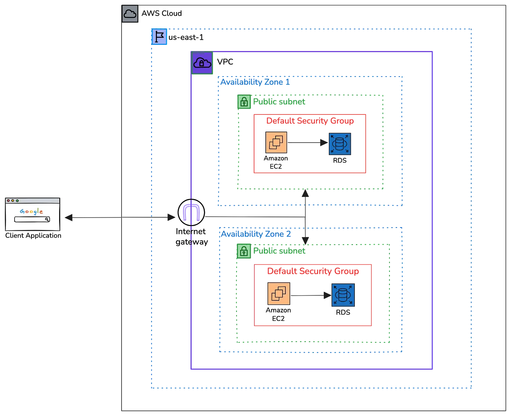
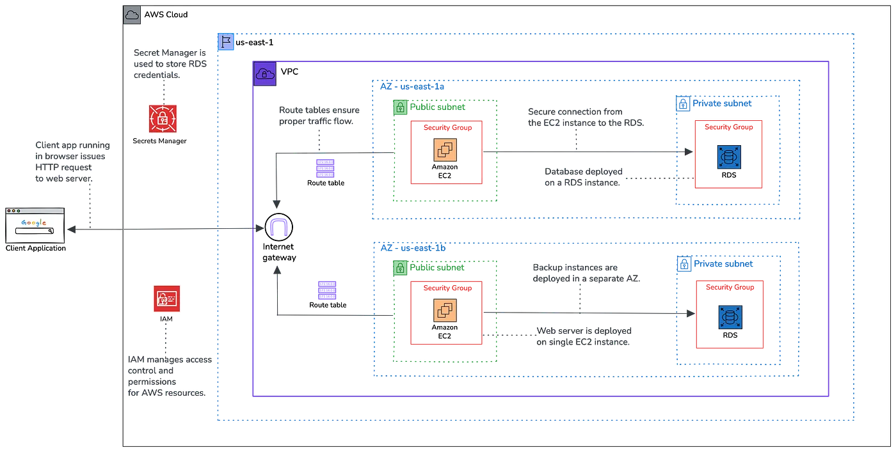

# 🏥 AWS Infrastructure Migration with CDK (Healthcare Platform Modernization)

This portfolio project demonstrates how a console-managed AWS infrastructure design can be represented as Infrastructure as Code using AWS CDK. It models a modernization scenario rather than documenting an independently verified production migration.

The goal of the migration is to improve **repeatability, security, and maintainability** by replacing manual configuration with automated, version-controlled infrastructure.

📖 **Architecture Deep Dive (Medium Article):**  
[From Console Chaos to CDK Control: Modernizing Healthcare Infrastructure on AWS](https://medium.com/@psalvador8/from-console-chaos-to-cdk-control-modernizing-healthcare-infrastructure-on-aws-a78f98049e2c)

---

# 📌 Project Overview

Many organizations initially build their infrastructure manually using the AWS Console.

While this approach can work for early experimentation, it creates long-term challenges such as:

- Infrastructure drift  
- Lack of reproducibility  
- Undocumented configuration  
- Inconsistent security policies  
- Difficulty creating new environments   

This project demonstrates how to modernize a **healthcare web application infrastructure** by rebuilding it using **AWS Cloud Development Kit (CDK)**.

The migration introduces:

- Infrastructure as Code
- Version-controlled infrastructure
- Improved networking and security architecture
- Automated infrastructure deployment

This approach transforms manually configured resources into a **programmable, repeatable cloud architecture**.

---

# 🧭 Architecture

This project illustrates the transformation from a manually configured AWS environment to a modern **Infrastructure-as-Code architecture using AWS CDK**.

---

## Legacy Architecture (Before Migration)



The legacy diagram represents a manually provisioned environment used as the starting point for this modernization scenario.

Console-managed environments can introduce operational challenges such as:

- Infrastructure configuration was not version-controlled
- Environment replication was difficult
- Security policies could drift over time
- Manual changes increased operational risk
- Infrastructure documentation was limited

These issues made the environment harder to maintain and scale.

---

## Modernized Architecture (After Migration)



The infrastructure was rebuilt using **AWS CDK**, enabling programmatic infrastructure definition and repeatable deployments.

Key architectural improvements include:

- Infrastructure defined as code using AWS CDK
- Version-controlled infrastructure deployments
- Consistent networking architecture
- Improved security segmentation
- Automated environment provisioning

Defining these resources in code improves repeatability and reviewability. Application reliability and scalability have not been benchmarked.

---

# 🧰 Technologies Used

- AWS CDK (TypeScript)
- Amazon VPC
- Amazon EC2
- Amazon RDS (MySQL)
- IAM
- AWS CloudFormation
- Node.js
- TypeScript

---

# ⚙️ Deployment Strategy

Infrastructure is defined using **AWS CDK**, which synthesizes infrastructure code into **CloudFormation templates**.

The deployment workflow includes:

1. Writing infrastructure definitions using CDK constructs  
2. Synthesizing CloudFormation templates  
3. Deploying resources using the AWS CDK CLI  
4. Managing infrastructure updates through version-controlled code  

This workflow supports repeatable infrastructure provisioning; deployments must still be tested and configured for each target environment.

---

# 🚀 Quick Deployment

### Prerequisites

- AWS account  
- AWS CLI configured  
- Node.js installed  
- AWS CDK installed  

Install AWS CDK globally:

```
npm install -g aws-cdk
```

From the repository root, enter the CDK app directory and install locked dependencies:

```bash
cd aws-migration
npm ci
npm run build
npm test -- --runInBand
npx cdk synth
```

Review the synthesized template and costs before deploying:

```bash
npx cdk deploy
```

**Lab warning:** The CDK stack defines an RDS database with `RemovalPolicy.DESTROY`. Deleting the stack can delete the database. This setting is intended for disposable environments, not databases containing important data. The EC2 security group also exposes HTTP (port 80) publicly; there is no HTTPS load balancer in this example.

CDK will synthesize the CloudFormation templates and provision the infrastructure.

---

# 🛟 Reliability & Scalability

The architecture incorporates several cloud-native reliability practices:

- Multi-AZ infrastructure support
- Private subnet isolation for backend services
- Managed database service (Amazon RDS)
- Security group segmentation
- Infrastructure defined as code for consistent deployments

These design choices demonstrate network segmentation and repeatable provisioning; they do not establish measured improvements in uptime or scalability.

---

# 🧠 Design Decisions

Several architectural decisions were made during the migration process.

- **AWS CDK** was selected to define infrastructure programmatically using TypeScript.
- **Custom VPC architecture** provides network isolation between public and private resources.
- **Private subnets** protect backend services from direct internet exposure.
- **Security groups** enforce least-privilege network access.
- **Infrastructure as Code** enables repeatable and auditable deployments.

These decisions transform the environment from manual configuration to **automated infrastructure management**.

---

# 🧩 Migration Challenges & Solutions

During the migration from console-based infrastructure to Infrastructure as Code, several architectural challenges needed to be addressed.

### Infrastructure Drift

Console-created resources often evolve over time without proper documentation.  
To solve this, all infrastructure components were redefined using AWS CDK constructs, ensuring the entire environment can be recreated from code.

### Networking Consistency

The legacy environment lacked a consistent network architecture.  
The CDK implementation introduced a structured VPC layout with public and private subnets to improve isolation and security.

### Security Standardization

Manual configurations can lead to inconsistent security policies.  
The CDK stack defines separate EC2 and RDS security groups and an EC2 role with the Systems Manager managed-instance policy. The database accepts MySQL connections from the EC2 security group.

### Environment Reproducibility

The console-based setup made it difficult to replicate environments.  
AWS CDK provides a repeatable definition of the infrastructure. Each deployment still requires appropriate account configuration and verification.

---

# 🏗️ System Design Principles

This project reflects several core cloud engineering principles.

### Infrastructure as Code

Infrastructure is defined programmatically and managed through version control.

### Security by Design

Private networking and controlled access improve the security posture of the system.

### Reproducibility

Entire infrastructure environments can be recreated from code.

### Maintainability

Infrastructure changes are managed through source control rather than manual console updates.

### Automation

Infrastructure provisioning becomes part of an automated deployment workflow.

---

# 🎯 What This Project Demonstrates

- Migrating console-based infrastructure to Infrastructure as Code
- AWS CDK infrastructure development
- Secure VPC networking architecture
- Private subnet design for backend services
- Infrastructure version control and automation
- Modern cloud infrastructure management practices

---

# 🚀 Potential Improvements

Future enhancements could include:

- Implementing Auto Scaling Groups
- Adding an Application Load Balancer
- Integrating CI/CD for infrastructure deployment
- Adding monitoring with CloudWatch dashboards
- Implementing automated security auditing

---

# 📁 Repository Structure

```
├── README.md
├── .github/workflows/cdk-validation.yml
├── aws-migration/
│   ├── bin/aws-migration.ts
│   ├── lib/aws-migration-stack.ts
│   ├── test/aws-migration.test.ts
│   ├── package.json
│   ├── package-lock.json
│   ├── cdk.json
│   └── tsconfig.json
└── docs/
    ├── legacy-architecture.png
    └── cdk-architecture.png
```

---

# 💡 Key Takeaway

Representing infrastructure as code improves reviewability, consistency, and maintainability; production security and reliability require further controls and validation.

Using AWS CDK allows engineers to treat infrastructure as software — enabling version control, automation, and repeatable deployments.

---

# 👤 Author

**Priscilla Salvador**  
Cloud & DevOps Engineer
